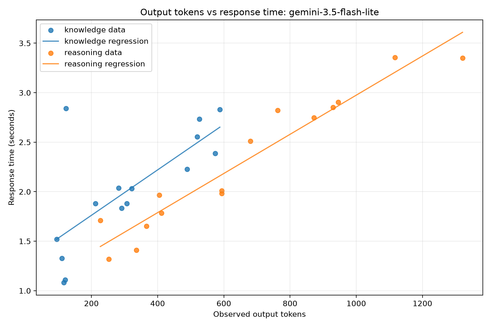
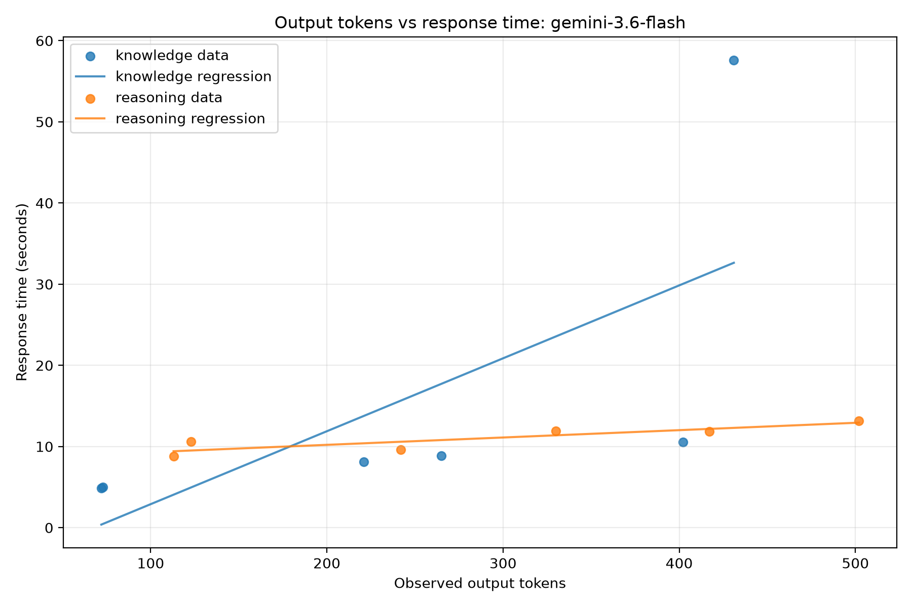
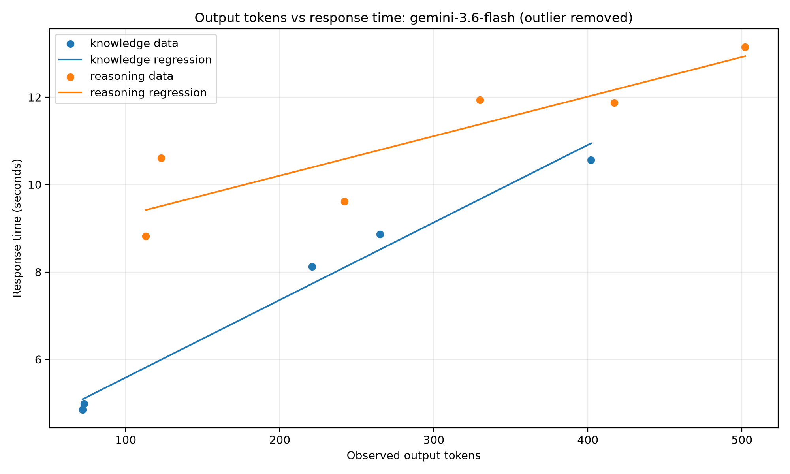

# 第1回 解答

## 演習

- 講座に固有の質問（宿題の3レベル）へのモデルの回答（要約でよい）：
- 用語集の正しい意味と比べて気づいたこと：
- 表示できたトークン数（入力 / 出力）：

## 宿題

- 取り組んだレベル：発展
- やったこと：

  Gemini APIを用いて、2種類のモデルと2種類の質問について、応答時間と出力トークン数を計測した。

### 仮説

本実験では、応答時間とトークン数の関係について、以下の3つの仮説を設定した。

1. **出力トークン数が増加するほど、応答時間は長くなる。**

2. **推論問題は知識問題よりも応答時間が長くなる。**

3. **Gemini 3.5 Flash LiteはGemini 3.6 Flashよりも応答時間が短い。**

### 結果

#### 応答時間と出力トークンの関係

横軸に実測出力トークン数、縦軸に応答時間を取り、知識問題と推論問題を区別してプロットし、それぞれについて単回帰分析を行った。

以下がそのグラフと単回帰式である。

*図1：Gemini 3.5 Flash Liteの出力トークン数と応答時間の関係*

*図2：Gemini 3.6 Flashの出力トークン数と応答時間の関係*

応答時間を \(t\)（秒）、実測出力トークン数を \(N\) とする。

\[
t = aN + b
\]

| モデル | 質問 | 回帰式 | 決定係数 \(R^2\) |
|---|---|---|---:|
| Gemini 3.5 Flash Lite | 知識 | \(t=0.002295N+1.3023\) | 0.5184 |
| Gemini 3.5 Flash Lite | 推論 | \(t=0.001978N+0.9974\) | 0.9259 |
| Gemini 3.6 Flash | 知識 | \(t=0.089842N-6.0882\) | 0.4558 |
| Gemini 3.6 Flash | 推論 | \(t=0.009046N+8.3955\) | 0.7740 |

#### 外れ値の除外

図2のGemini 3.6 Flashでは、知識問題において、431トークンの出力に対して応答時間が57.6183秒となる観測値が1件存在した。この値は他の観測値と比較して極端に大きく、トークン数以外の影響が含まれていると考えたため除外して考えることにした。

そこで、応答時間が最大となった1件を除外し、残りの知識問題5件と推論問題6件を用いて回帰分析を再度行った。その結果を図3に示す。

*図3：Gemini 3.6 Flashの出力トークン数と応答時間の関係（知識問題の外れ値除外後）*

外れ値を除外した知識問題の回帰式と決定係数は、以下のようになった。

\[
t = 0.017746N + 3.8100
\]

\[
R^2 = 0.9802
\]

除外前後を比較すると、回帰直線の傾きは0.089842から0.017746へ減少し、決定係数は0.4558から0.9802へ上昇した。

以降は、外れ値を除外した回帰式を用いる。

#### 100トークン出力時の予測応答時間の比較

各モデル・質問について求めた単回帰式を用いて、100トークンを出力する場合の応答時間を推定した。

回帰式を

\[
t=aN+b
\]

とすると、100トークン出力時の予測応答時間は

\[
t(100)=100a+b
\]

で求められる。

計算結果を以下に示す。

| モデル | 知識問題 | 推論問題 |
|---|---:|---:|
| Gemini 3.5 Flash Lite | 1.532秒 | 1.195秒 |
| Gemini 3.6 Flash | 5.585秒 | 9.300秒 |

### 気づき・疑問

#### 知識問題と推論問題における応答時間の違い

100トークン出力時の予測応答時間を比較すると、Gemini 3.5 Flash Liteでは、知識問題が1.532秒、推論問題が1.195秒となり、推論問題の方が短かった。

一方、Gemini 3.6 Flashでは、知識問題が5.585秒、推論問題が9.300秒となり、推論問題の方が長かった。

このように、知識問題と推論問題の応答時間の関係は、モデルによって異なることがわかった。

また、実際の出力内容を確認したところ、今回の知識問題と推論問題については、どちらのモデルも正しい回答を生成できていた。

したがって、今回扱った程度の難易度の推論問題であれば、応答時間が短いGemini 3.5 Flash Liteでも十分に対応できると考えられる。

#### 内部推論トークン数と応答時間の関係

Gemini 3.5 Flash Liteでは、推論問題よりも知識問題の方が100トークン出力時の予測応答時間が長くなるという、予想に反する結果が得られた。

この原因を考えるため、APIから取得できた内部推論トークン数（thinking_tokens）に着目した。Gemini 3.6 Flashでは、知識問題と推論問題の両方で内部推論トークン数が記録されていたため、それぞれの平均を比較した。

| 項目 | 知識問題 | 推論問題 |
|---|---:|---:|
| 平均内部推論トークン数 | 945 | 1301 |
| 平均応答時間（外れ値を含む） | 15.833秒 | 10.999秒 |

Gemini 3.6 Flashでは、推論問題の方が知識問題より平均356トークン多く内部推論に使用していた。

一方、平均応答時間は知識問題の方が長かったが、これは57.6183秒という極端に遅い観測値の影響を受けている。外れ値を除いた回帰分析では、100トークン出力時の予測応答時間は知識問題が5.585秒、推論問題が9.300秒となり、推論問題の方が長かった。

この結果から、APIの応答時間には、最終的に出力されるトークン数だけでなく、内部推論に使用されるトークン数も影響する可能性があると考えられる。

ただし、Gemini 3.5 Flash Liteでは内部推論トークン数を取得できなかったため、知識問題の方が応答時間が長くなった原因を直接検証することはできなかった。

### 仮説の検証結果

以上より、3つの仮説について以下の結論が得られた。

1. **仮説①：支持された。** 出力トークン数が増えるほど応答時間も長くなる傾向が見られた。
2. **仮説②：一部支持された。** Flashでは推論問題の方が遅かったが、Flash Liteでは逆の結果となった。
3. **仮説③：支持された。** 今回の測定ではFlash Liteの方がFlashより応答時間が短かった。

### 無料枠のレート制限について

Google AI Studioで確認した無料枠の上限は、Gemini 3.6 Flashが5 RPM、Gemini 3.5 Flash Liteが15 RPMであった。

今回の実験ではAPI呼び出し間に15秒の待機時間を設けたため、レート制限を考慮しながら測定を実施できた。

また、両モデルのTPM上限は250,000、1日あたりのリクエスト上限（RPD）はFlashが20回、Flash Liteが500回であった。

今回のように短い質問を繰り返す実験では、TPMよりもRPMやRPDが制約になりやすいと考えられる。
